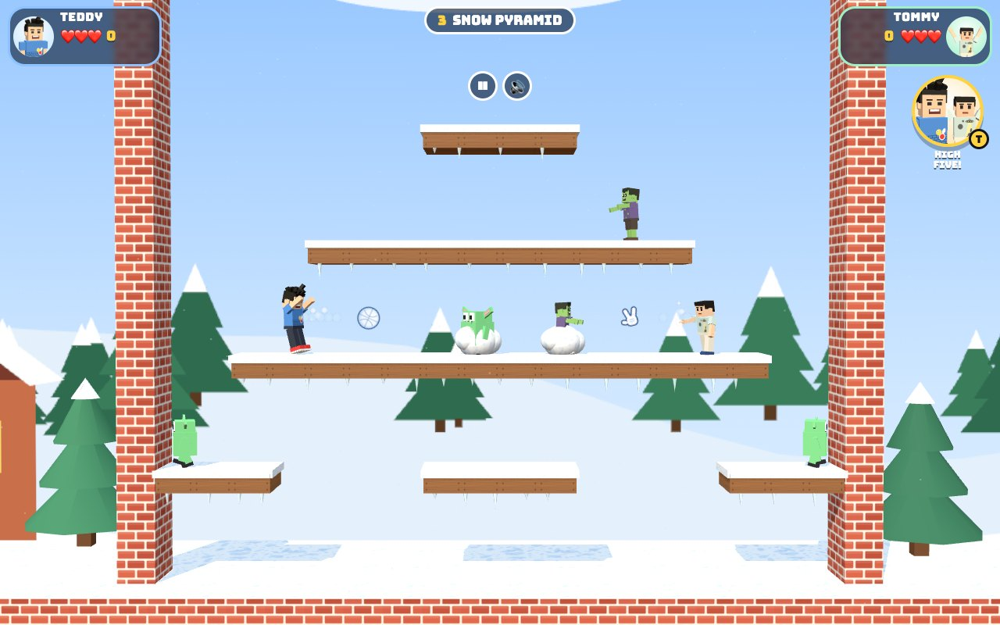
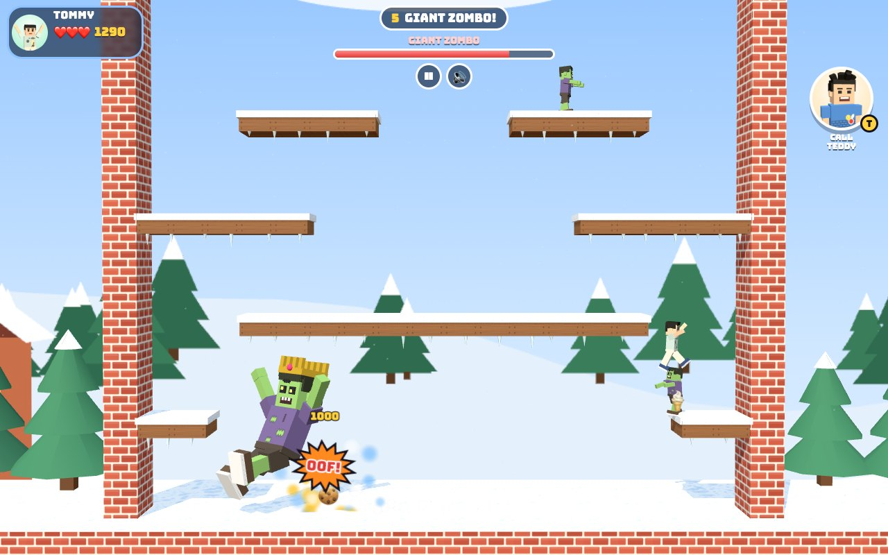
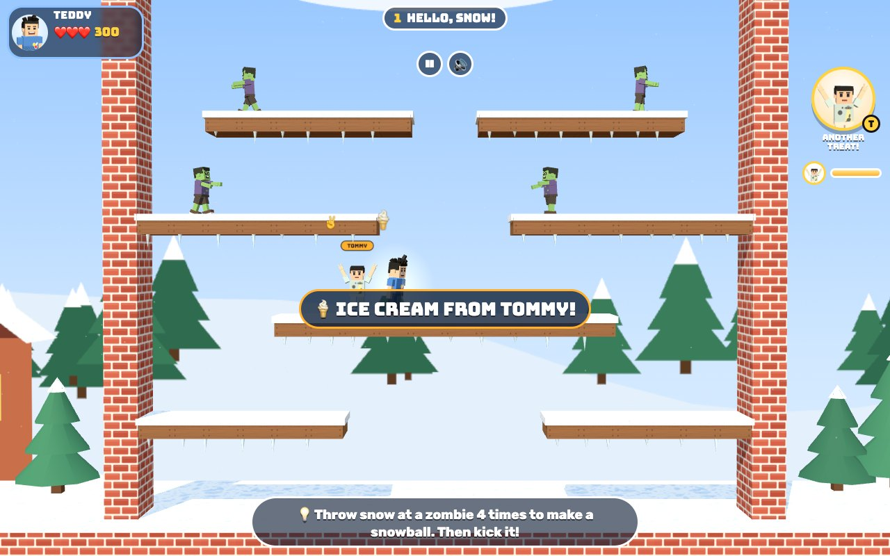
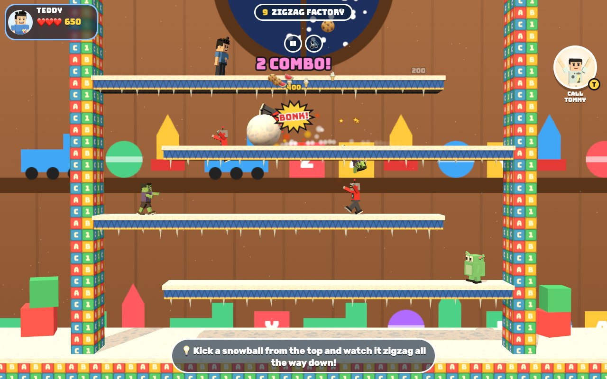

# Snow TT Bros

[](https://adong.github.io/snow-tt-bros/)

Snow the zombies into giant snowballs and roll them away. 20 floors, 1 or 2 players.

**中文：** 把僵尸冻成大雪球，滚起来撞倒一大片！20 层，单人或双人。

Press **?** any time (or tap the round **?** button on the left edge) to see the keys. The game waits while you look.
Tap the language button under it (the A文 icon) to switch between English and 中文; the dashboard and every game remember the choice.

A single-screen snowball platformer starring Teddy and Tommy, built with Claude Code from plain JavaScript and Three.js on the shared Claude Games kit.
Climb a tower of 20 snowy floors. On each floor you snow the silly baddies until they turn into big snowballs, then kick the snowballs so they roll and bounce down the ledges, bonking every baddy they hit.
There's a boss every fifth floor. It's best with two brothers on one keyboard, and in 1-player mode the other brother drops in whenever you call him.
There are no image, model or audio files. The brothers are the kit's blocky characters, every texture is painted on a canvas, and every sound is synthesised.
Nothing is scary: getting touched means a dizzy flop with cartoon stars, and the "hurry up!" ghost only tickles.



## Play

- **Double-click `index.html`.** It works offline because Three.js and the kit are copied into `kit/`. Without internet the title font falls back to Arial Black.
- **Send one file:** `dist/snow-tt-bros.html` is the whole game in one page (about 840 KB). AirDrop or email it, then open it in a browser.
- Rebuild that file after any edit: `python3 kit/tools/bundle.py . --name snow-tt-bros`

On the title screen, tap a card: **TEDDY** or **TOMMY** for 1 player, or **BOTH!** for 2 players on one keyboard (or one iPad).

- **🐣 EASY** gives 5 hearts instead of 3, slower baddies, snow that stays on longer, snowballs that wait longer before breaking free, a later "hurry up", bosses with 2 less health, and you keep your potions when you get bonked.
- **◀ FLOOR ▶** starts on any floor you've reached before. Progress is saved in the browser.

## Controls

| | 1 player | Teddy (2 players) | Tommy (2 players) | Touch |
|---|---|---|---|---|
| walk | ← → or A D | A D | ← → | slide on the pad |
| jump | ↑, W or Space | W | ↑ | ⬆️ |
| throw snow / kick a snowball | F, L or J | F | L (or Enter) | ❄️ |
| drop down through a ledge | ↓ or S + jump | S + W | ↓ + ↑ | ▼ on the pad + ⬆️ |
| call your brother / high five | T | T | T | the big face button |

- **P** or Esc pauses, and **M** turns the sound on or off. The ❚❚ and 🔊 buttons at the top do the same.
- On the title screen: 1, 2 or 3 picks a card straight away, ← → choose, Enter starts, ↑ ↓ change the floor, E turns easy on or off.
- The touch controls show up on a touch screen. In 2 players each brother gets his own pad and buttons, in his own corner.

## How to play

- **Throw snow.** Each hit covers a baddy a bit more: feet, waist, shoulders, then the whole baddy, which turns into a big snowball. That takes 4 hits.
  - Teddy throws with his basketball jump-shot motion, and his snowballs have basketball seams.
  - Tommy flings his snow one-handed, and his shots are ✌️-shaped.
  - A half-covered baddy is slow, and from half-covered up it can't hurt you. Leave it alone for a few seconds and it shakes the snow off, one layer at a time.
  - A finished snowball blinks and wobbles after about 7 seconds (10 on easy), then the baddy breaks free: "BRRR!"
- **Kick the snowball.** Press throw next to it. Walking into it pushes it slowly, and pushing it off a ledge sends it rolling too.
  - A rolling snowball falls down the ledges, bounces off walls and solid blocks ("BOING!"), and bonks every baddy it touches.
  - It launches any other snowball it hits as well. It breaks on its 4th wall bounce.
- **Combos.** Every baddy one snowball bonks is worth double the one before (200, 400, 800...). Two or more rain treats (🍦 🍪 🍉) from the sky, and 4 is a **SUPER COMBO!**
  - Bonked baddies tumble away and pop into treats too. Grab them for points.
- **Potions** drop from some bonked baddies. Most last until you get bonked:
  - 🔴 **ZOOMY SHOES!**: run faster.
  - 🔵 **BIG SNOW!**: bigger shots that count as two hits.
  - 🟡 **LONG THROW!**: snow flies much further.
  - 🟢 **BALLOON!**: float around for 7 seconds and bowl over every baddy you touch (hold jump to go up). Nothing can hurt you while you float.
- **Bonk.** Touching a baddy that isn't snowed up means a dizzy flop: you sit down with stars circling your head and lose a heart. Then you blink and nothing can hurt you for a moment.
  - Out of hearts in 1 player? **KEEP GOING!** carries on from the same floor with full hearts, as often as you like.
  - In 2 players a brother who runs out rests until he presses his throw key to jump back in. A high five brings him back too.
- **Hurry up!** Stay on one floor for 45 seconds (70 on easy) and a see-through ghost-snowman in a top hat floats after you. He's harmless.
  - His touch tickles you (you giggle for a second, and no heart is lost), but the baddies get zippy while he's around.
  - A snowball throw scares him off for a moment. There's no ghost on boss floors.
- **Floor clear!** The camera zooms in and the brothers celebrate with their signature moves, then it's up to the next floor.
  - Teddy does Mike Tyson-style boxing (💥) on odd floors and his basketball jump shot (🏀 SWISH!) on even floors.
  - Tommy does his Y pose with peace fingers (比耶) and ✌️ ⭐.
- An extra heart every 20,000 points.

### The tower

| Floors | World | Baddies | Boss |
|---|---|---|---|
| 1–5 | Snowy Backyard | zombies, gremlins | **GIANT ZOMBO**, a huge zombie in a crown (5 hits) |
| 6–10 | Toy Workshop | robots, zombies | **ROBO-RUMBLE**, a giant robot (6 hits) |
| 11–15 | Ice Cave | gremlins, robots | **BIG FLUFF**, a fluffy snow monster (6 hits) |
| 16–20 | Grump Castle | everyone | **KING GRUMPCASTLE**, a grumpy walking castle (8 hits) |

- **Bosses** walk the bottom floor and throw out little baddies for you to snow. Only a rolling snowball hurts a boss ("OOF!"), and snow just puffs off it.
  - Roll snowballs down onto the boss from the ledges above. Each boss keeps 2 tiles away from the side walls, so the corners down there are safe.
  - When a boss has nobody left for you to snow, it quickly sends another baddy out.



## Call your brother (companion)

**In 1 player**, your brother is always there to help: Tommy comes when Teddy plays, and Teddy comes when Tommy plays. Press **T** or tap the big button with his face (top right) as often as you like. There's no cooldown.

- **He drops in** from the top of the screen, right next to you (he follows you if you run off), and **says hi with his signature move**. Tommy does his Y pose with ✌️ and ⭐, and Teddy throws a Tyson-style jab and straight 💥.
- **He hands you a treat:** a 🍦 💧 🧃 🍪 🍉 or 🍌 arcs over into your hands, with a toast like **"🍦 ICE CREAM FROM TOMMY!"** (+300).
- **He plays with you for about 10 seconds.**
  - He snows the nearest baddies with his own throw and kicks snowballs at the others. Baddies can't hurt him, and his points go to you.
  - The little bar with his face under the button shows the time left, and the button glows while he's there.
- **He has your back:** while he's there, one hit on you is blocked: **"TOMMY SAVED YOU!"** (or "TEDDY SAVED YOU!"). The baddy gets knocked back dizzy instead, and your brother does his hello move again.
- **Press again** while he's there and he gives you another treat. That also fills his time back up and gets his guard ready to block another hit. If he's already waving goodbye, he comes right back.
- **Goodbye:** at the end he does his goodbye move (Tommy's Y pose again, or Teddy's jump shot with a 🏀) and jumps off the top of the screen.

**In 2 players**, the same button (or **T**) is a **HIGH FIVE**.

- Both brothers stop for their signature moves, and ✋ 🤚 HIGH FIVE! gives you both a **6-second power burst**: fast running, big snow and long throws, with sparkles.
- It also brings back a brother who ran out of hearts.
- Then it rests for 20 seconds (12 on easy). The ring on the button fills back up and shows the countdown.



## Make it yours

- **The floors** are ASCII maps in `js/floors.js`, one per floor, with the legend at the top.
  - Each map is 15 rows of 20 characters: `#` solid block, `=` snowy ledge (jump up through it), `.` air, `1` / `2` where Teddy and Tommy start, `z` `r` `g` for a zombie, robot or gremlin, and `B` for the boss.
  - Ledges 3 rows apart are one easy jump, and gaps up to 3 tiles wide can be jumped across. Leave gaps at the ends of ledges so snowballs can roll down.
  - Each floor also has a `name`, a `theme` (`yard`, `toys`, `ice`, `castle`), an optional `tip` shown at the start, `potions` (how many drop) and `boss` (`zombo`, `robo`, `fluff`, `castle`).
- **After editing a floor, run the check:** `node tools/check.js` (or `game.check()` in the browser console). It tells you if a ledge can't be reached, something starts inside a wall, and so on.
- **The feel** is set by `TUNE` (jump, speed, throw range, snowball speed, visit length...), `MODES` (normal and easy), `KINDS` (the baddies) and `BOSSES` at the top of `js/sim.js`.
- **The name** lives in one place: `ST.TITLE` in `js/title.js` (the page title and the logo both come from it).

## How it works, and how it's tested

- The rules (`js/sim.js`) have no Three.js and no DOM in them. A floor is plain state stepped at a fixed 60 frames a second. The same code runs the game, the title-screen demo (both brothers on autopilot), the companion's brain and the headless check. The view (`js/view.js`) only reads that state and turns its events into poofs, stars, comic bursts and sounds.
- **The autopilot** (`ST.Bot`) finds its way around by simulating real jumps, drops and walk-offs with the game's physics from every tile of every ledge. So it only uses moves that actually work. The companion is this autopilot.
- **The floor check** (`node tools/check.js`, about 4 seconds) does this for every floor:
  - the map shape, solid outside walls and ground, both starts present;
  - nobody starts inside a wall or in mid-air, and no baddy starts right next to a brother;
  - with the real jump physics, every ledge can be reached from both starts, and there's a way back down from every ledge (no traps);
  - on boss floors, a snowball kicked from every ledge can roll down to the boss;
  - a soak: two invincible autopilot brothers on 3 seeds, plus a 1-player run with the companion called in every 11 s, must clear the floor in normal and easy mode.

  Then it proves the check can fail. Five deliberately broken floors must be caught (a ledge too high, a zombie inside a wall, a hole in the wall, a gremlin in mid-air, a short row), and brothers who do nothing must *not* clear floor 1 or the boss on floor 5.

  Last run: all 20 floors OK and 160 autopilot runs cleared, in 5–43 s each (the autopilot can't be hurt, so real kids take longer). All 7 sabotage cases were caught.
- **Console hooks** (`window.game`):

```js
game.start({ mode: '2p', floor: 5, easy: true })  // jump straight into a game ('1p' takes hero: 'teddy' | 'tommy')
game.step(2)            // advance 2 s and draw (the hidden Browser pane throttles animation)
game.auto()             // autopilot plays the brothers; game.auto(false) gives them back
game.god()              // nothing can hurt the brothers
game.buddy()            // call the companion (or high-five in 2P)
game.floor(10)          // go to a floor
game.snowAll()          // every baddy becomes a snowball
game.check()            // the floor check, in the browser
game.freeze(); game.keepAwake(); game.calm(); game.peek(); game.setTouch(true)  // for screenshots
```

- **Screenshots:** `node tools/shoot.js` replays `tools/shots.json` in headless Chrome against the preview server (port 8760) and saves `docs/*.jpg`.



## Files

```
index.html          page, HUD, menus, touch controls (CSS inline)
js/title.js         the game's name (ST.TITLE)
js/floors.js        the 20 floors as ASCII maps, and the worlds
js/sim.js           the rules: physics, snow, snowballs, combos, potions, bosses, ghost, companion, autopilot
js/check.js         the floor check (used by tools/check.js and game.check())
js/poses.js         extra poses: jump-shot throw, ✌️ throw, kick, push, dizzy, tickle, balloon, high five
js/sfx.js           the game's own synth sounds (poof, roll, bonk, combo, boss hits, slide whistle...)
js/art.js           canvas paintings and textures, gremlin / snow monster / castle / ghost-snowman models
js/view.js          Three.js scene: floors, characters, snow, particles, comic bursts, camera
js/game.js          screens, input, HUD, companion button, events to sounds and banners, test hooks
js/zh.js            中文: the dictionary and rules for every word the player sees (Kit.lang, kit/lang.js)
tools/check.js      node tools/check.js: the headless floor check
tools/shoot.js      headless-Chrome screenshots (tools/shots.json -> docs/)
docs/               screenshots
kit/                copy of ~/claude-games/kit (python3 ../kit/tools/sync.py .); don't edit it here
dist/snow-tt-bros.html   the single-page build
```

## Kit candidates

These live in this game's own JS for now, and are worth moving into `~/claude-games/kit` if another game wants them:

- **Poses** (`js/poses.js`):
  - Teddy's jump-shot *throw* (arms overhead, then the release) and Tommy's one-arm throw with peace fingers;
  - a kick, a push, a dizzy sit-down with stars, a giggle, hanging from a balloon, a high five;
  - still-legged wave, peace and give.
- **Platformer physics with one-way ledges** and drop-through (`moveBody` in `js/sim.js`).
- **The jump-graph autopilot** (`buildNav` + `Bot` in `js/sim.js`). It simulates every jump from every tile, then plans with Dijkstra. It doubles as a reachability check for any grid platformer.
- **The ✌️ snow-hand sprite**, drawn by hand on a canvas so it doesn't depend on an emoji font, and a snowball with basketball seams (`shotTexture` in `js/art.js`).
- **Models:** a gremlin, a snow monster, a walking castle with a grumpy face and a gate that opens, and a ghost-snowman (`js/art.js`).
- **A points particle system** with per-particle colour, size and fade in one draw call, and floating comic bursts and words (`js/view.js`).
- **Synth sounds** on `tone` / `hiss`: snow poof, rolling rumble, combo arpeggio, slide whistle, high-five clap, boss thump (`js/sfx.js`).
- **The headless-Chrome screenshot runner** (`tools/shoot.js`, adapted from Volleyball Teddy's).

## Not verified

- **Sound:** every effect is wired up, but nobody listened to them in this build.
- **Real touch devices:**
  - the pad, buttons and 2-player split were tested with synthetic pointer events at iPad size in the Browser pane, not on a real iPad or iPhone;
  - performance on an iPad wasn't measured.
- **Kids playing it:** difficulty is tuned by hand and checked with the autopilot, which can't be hurt. The real balance for an 8- and a 5-year-old still needs a playtest.
- **Portrait phones** work but the floor is small; it's made for landscape iPads and computers.
